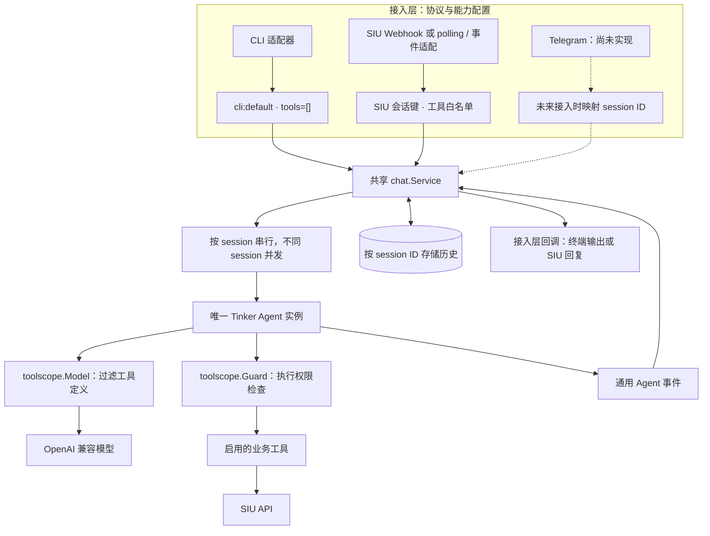
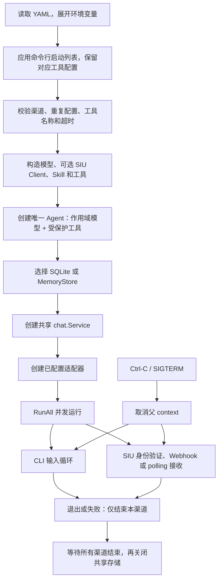
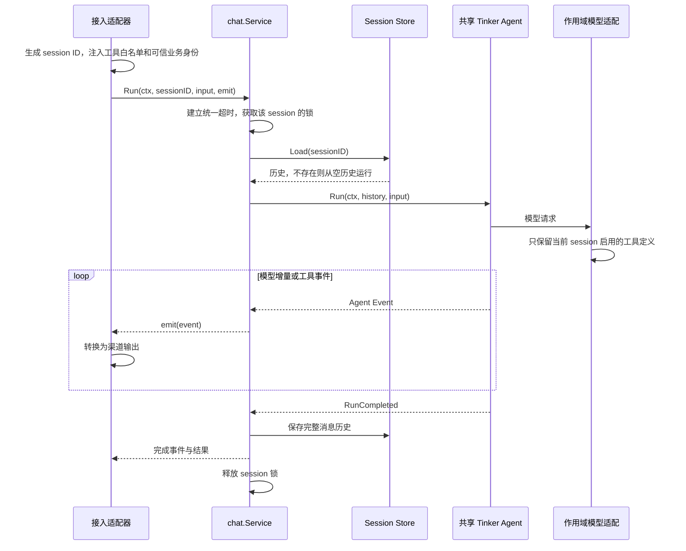
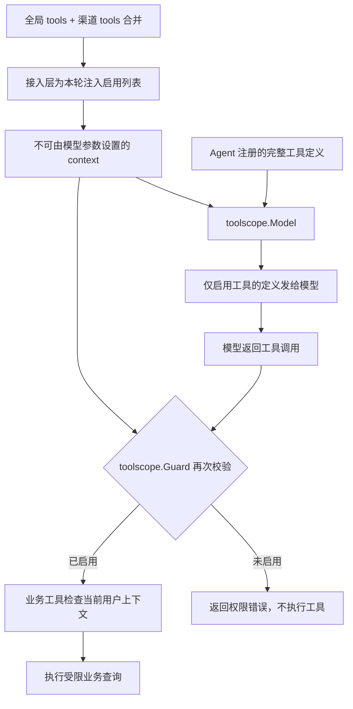
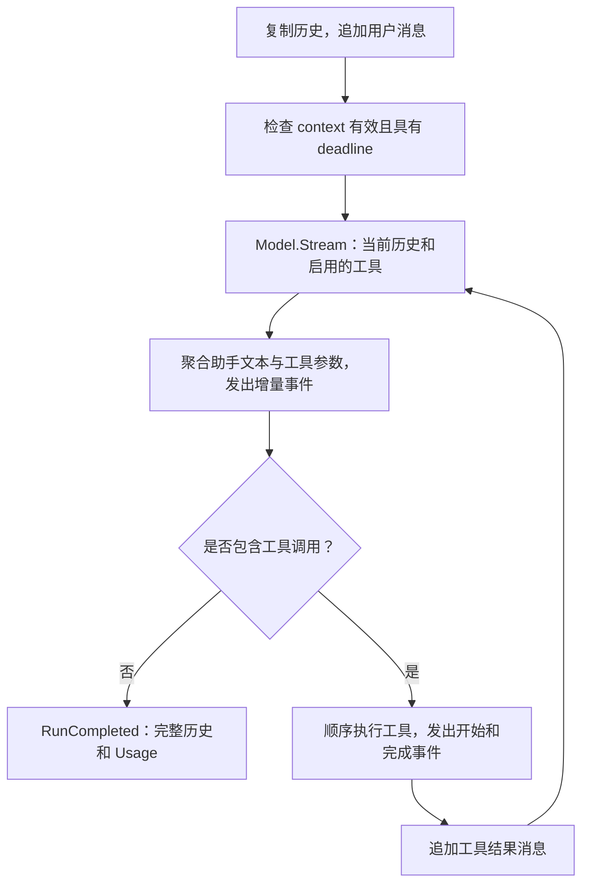
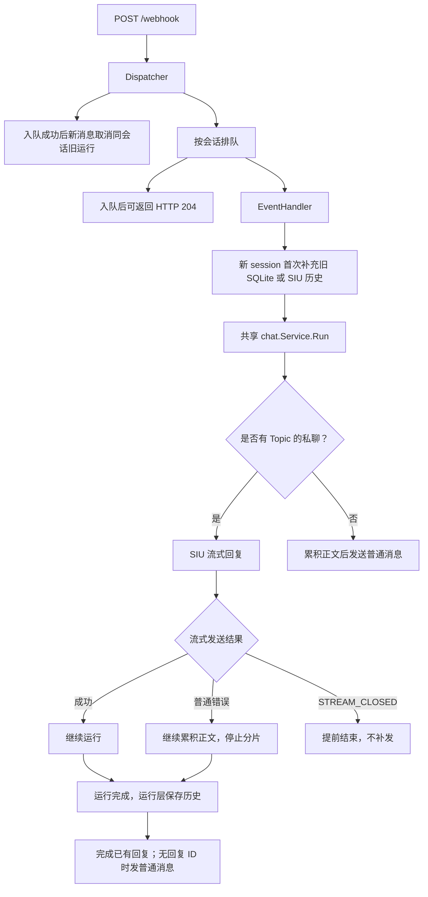

# TinkerBot 架构说明

对应 2026-10-14 实现：一个共享 Tinker Agent，多个并发 channel，各自映射到独立 session。运行层不识别 CLI、SIU 或 Telegram，只接收 session ID、输入、运行 context 和事件回调。

## 当前 Agent 能力与边界

下表依据本项目及相邻 `../tinker` 工作区的实际调用链整理。代码接入不等于已通过真实模型、SIU 或 AnySearch 服务联调。

| 能力 | 当前实现 | 条件与边界 |
| --- | --- | --- |
| 对话与工具循环 | OpenAI 兼容接口、流式文本、顺序工具调用 | 模型必须支持相应协议；供应商能力不会由提示词自动获得 |
| CLI / SIU 接入 | 可同时运行；SIU 支持私聊、群聊、Topic、Webhook / polling | Telegram 未实现；polling 不补停机消息，不保证持久确认 |
| 会话与记忆 | SQLite 持久化或内存存储；同 session 串行，不同 session 并发 | CLI `/new` 清空会话；历史窗口按消息数而非 token 计量 |
| 历史压缩 | 启动入口启用旧消息文本摘录，保留最近若干摘要条目 | 不是模型生成的语义摘要；长文本截取可能丢失关键约定；工具调用轮裁剪仍有协议完整性风险 |
| 联网查询 | `web_search` 搜索，`web_visit` 提取网页正文 | AnySearch 后端、可选 API key；没有交互浏览器；响应最多 2 MiB，模型内容最多 24000 个 Unicode 字符 |
| SIU 查询 | 当前 Topic 消息、联系人、聊天搜索、用户资料 | 按工具配置启用；部分接口需要特权 Bot；群聊禁用私聊数据工具 |
| SIU 操作 | 发送已有图片；可选编辑、撤回、客户端事件 | 不生成图片；当前图片工具缺省填 800×600，并未读取真实尺寸；事件提交不等于客户端执行完成 |
| 图片输入 | SIU 当前消息、远端历史与 Fork 的图片 URL 作为多模态输入 | 依赖相邻 Tinker 改动、模型视觉支持及 URL 可访问性；没有独立 OCR 工具 |
| 文件正文 | PDF、DOCX、PPTX、XLSX、UTF-8 CSV / TXT 提取 | 需要 `uv`、预装 MarkItDown 依赖并从项目目录启动；每消息最多 5 文件、单文件 20 MiB、总下载 50 MiB、正文 64 KiB；历史文件不重新提取 |
| Skill | 有 description 的 Skill 先列目录，通过 `load_skill` 读取；其余全文注入 | 提供指令，不自动提供 shell、文件操作或执行环境；不负责业务授权 |
| 运行控制 | 超时、最多工具调用数、用户停止、Topic 分叉/删除、失败提示 | `max_steps` 未配置或为 0 时按 20 次工具调用；文件预处理目前不计入 `agent.run_timeout` |
| 权限与观测 | 工具定义过滤及执行白名单、可信 SIU 身份、阶段 JSON 日志 | 通用 Schema 检查目前只覆盖 JSON 和必填字段，其余依赖各工具校验 |

尚未实现音视频理解、语音转写、OCR、独立文档库、图片生成、通用 shell / 文件操作、浏览器交互或模型主动创建的定时任务。文档转换子进程是固定用途的内部实现，不是可供模型调用的执行工具。

## 1. 整体架构



CLI 和 SIU 不再分别构造 Agent。启动入口只创建一次模型、Agent、共享运行服务，再将服务传给各适配器。

| 层           | 模块                                  | 职责                                            |
| ------------ | ------------------------------------- | ----------------------------------------------- |
| 组装         | `cmd/tinkerbot/main.go`             | 配置、模型、工具、Agent、存储及适配器组装       |
| 接入         | `internal/channel/cli`              | stdin、stdout、命令和 CLI 会话 ID               |
| 接入         | `internal/channel/siu`              | SIU 身份验证、Webhook 或长轮询接收生命周期       |
| SIU 适配     | `internal/events`、`internal/run` | 协议事件、会话调度、运行取消、消息交付        |
| SIU 历史适配 | `internal/conversation`             | 将旧历史或 SIU 历史转换为通用消息，注入用户身份 |
| 运行         | `internal/chat`                     | session 历史、单轮超时、同会话串行化            |
| 工具能力     | `internal/toolscope`                | 从可信 context 读取启用列表，控制可见性与执行   |
| 业务工具     | `internal/tools/siu`                | 查询、消息操作和客户端事件工具                        |
| 存储         | `internal/storage`                  | SQLite 新 session 表及旧 SIU 表                 |
| Agent SDK    | 本地 Tinker                           | 模型流、工具调用循环、通用消息与事件            |

本地依赖为 `replace github.com/111hell/tinker => ../tinker`，要求将 Tinker 放在本项目的相邻目录。运行层与渠道适配在本项目中实现。

## 2. 启动与多渠道生命周期



支持 CLI 和 SIU 各一个同时运行，Telegram 尚未实现。单个渠道退出或运行失败不会取消其他渠道；失败立即记日志，`RunAll` 等全部渠道结束后返回错误。公共依赖构造或配置校验失败则无法进入运行阶段。

## 3. Session 处理时序



运行层将 session ID 当作不透明字符串。CLI 接入层使用 `cli:default`；SIU 按 Topic 使用 `siu:<TopicID>`，无 Topic 私聊使用 `siu:user:<UserID>`，群聊使用 `siu:group:<GroupID>`。命名空间避免渠道间会话碰撞，同一渠道的不同 Topic 也分别保存历史。

`Run`、`History`、`Initialize`、`Reset` 使用同一组 session 锁。同会话操作串行，不同会话可以并发；等待锁时可取消，锁无人持有或等待后回收。事件回调在锁内执行，不能重入同一 session 的运行服务。

模型错误、超时或增量事件回调失败时不提交该轮历史。`RunCompleted` 先写入历史，再交付完成事件。已显示的部分输出不会撤回；最终渠道交付失败也不会回滚已经保存的历史。

## 4. 工具 scope

工具实现一次注册到共享 Agent。工具列表由全局和渠道配置合并而成，再由每个 session 的可信 context 携带启用列表，模型请求和实际执行都检查这个列表。运行层和工具权限模块均不根据渠道名称分支。



| 渠道配置                   | 模型可见范围              | 实际查询范围                         |
| -------------------------- | ------------------------- | ------------------------------------ |
| CLI 显式`tools: []`      | 无业务工具                | 无 SIU 查询权限                      |
| SIU`siu_list_messages`   | 当前 session 能看到此工具 | 当前用户私聊，返回结果筛选当前 Topic |
| SIU`siu_search_contacts` | 当前 session 能看到此工具 | 当前用户联系人                       |
| SIU 显式`tools: []`      | 无业务工具                | 即使模型构造工具名，也不能执行       |

SIU 工具从接入层注入的 `UserID` / `TopicID` / `GroupID` 读取业务身份，模型只提供业务参数。新增查询和消息操作工具按配置启用；群聊隐藏并拒绝私聊数据工具。完整列表见 [Bot API 接入说明](siu-bot-api.md)。给其他渠道添加 SIU 工具名称，不会自动赋予 SIU 用户身份；没有可信身份时工具报错。

工具过滤不修改共享注册表，context 内的启用列表独立复制，因此并发 session 不会互相改变工具范围。模型和 Skill 仍是共享配置；系统提示词由通用助手行为说明与 agent.system_prompt 组成；Skill 正文在启动时加入提示词，不负责授权。

## 5. Tinker Agent 循环



Tinker 持有模型、系统提示词和工具实现，不持有跨轮 session 历史。`agent.run_timeout` 限制共享运行服务中的等待与模型/工具执行，目前不包含之前的 SIU 文件预处理。`agent.max_steps` 未配置或为 0 时限制为 20 次工具调用，并非 20 次模型请求。`toolscope.Guard` 检查执行白名单、JSON 和必填字段，具体参数约束由各工具补充；目前不是完整 JSON Schema 校验。Skill 支持按需 `load_skill` 渐进式加载。工具错误作为 JSON 错误结果交回模型，模型流错误终止该轮。

## 6. SIU 接入流程与兼容行为



SIU 适配层继续保留以下协议行为：

- 同会话串行，跨会话最多 8 个 Handler 并发；待处理事件最多 100 个，满时返回 503，控制事件仍可处理；空闲 lane 5 分钟回收。
- 入队成功的新消息取消同会话活跃运行，排队旧消息通过最新消息检查跳过。取消不会影响 CLI 或其他会话的 context。
- `stop_responding` 按用户消息 ID 取消运行，兼容停止先于消息到达；`skip_thinking` 按 Bot 回复 ID 只停止思考交付，不改变模型请求或正文运行。
- `fork_topic` 导入初始消息；`delete_topic` 删除新 session 及对应旧历史。
- 群聊、无 Topic 私聊使用普通回复；编辑事件使对应会话缓存失效，不触发新回复；未知事件忽略。
- 流式发送普通错误时继续累积正文，有回复 ID 则完成原回复，无回复 ID 才发送普通消息；流已关闭则停止补发。完成失败记录错误，不另发重复消息。最终交付在历史保存之后。

Webhook 按 Event ID 做进程内有界去重；单个坏事件不会阻止同批后续控制事件。204 表示事件分发完成，不表示模型回答完成。后台处理使用 Scheduler 的 context，不继承单次 Webhook 请求的取消。处理失败记录日志，不自动重试。

`internal/events`、`internal/conversation` 和 `internal/run` 是 SIU 适配实现的一部分；它们现在调用共享运行服务，不再直接构造或运行另一套 Agent。SIU 已统一使用全局提示词与 `agent.run_timeout`，原固定 30 分钟超时已移除。

文件输入在 `EventHandler.runAgent → conversation.AttachmentReader → Client.DownloadMedia → document.Converter` 中提取，然后作为文本交给共享运行层。转换器调用固定版本的离线 MarkItDown 脚本，临时原件转换后删除；下载/转换均可随当前运行取消。每消息最多 5 个文件、正文输入总量 64 KiB，失败和截断会显式标记。该路径位于调度后的 Topic 运行中，Webhook 和 polling 共用；没有引入 smolmem 或独立文档存储。图片附件走 Tinker 多模态 URL 输入；初始化历史不提取旧文件正文，详见 [文件正文读取](siu-bot-api.md#文件正文读取)。

Tinker 的 `c7acbed` 已增加图片消息与 reasoning 字段映射；本项目要求相邻 Tinker 包含该提交。SIU 思考内容交付仍要求供应商实际返回对应字段，且运行时收到 `Delta.Reasoning`。

## 7. 存储、配置与兼容

| 项目         | 当前行为                                                                            |
| ------------ | ----------------------------------------------------------------------------------- |
| 新历史表     | `agent_sessions`，主键为 session ID，消息保存为 JSON                              |
| 旧 SIU 表    | `conversations`，主键为 SIU 会话键，兼容原始 TopicID，用于补充历史                           |
| 旧数据导入   | 新 SIU session 不存在时读取旧历史；没有旧历史时查询 SIU，初始化时不覆盖已有 session |
| 内存模式     | `sqlite.path: ""`，所有历史随进程退出清空                                         |
| SQLite 模式  | 路径非空，所有 channel 的 session 都持久化；默认`tinkerbot.db`                    |
| 统一配置模板 | `config.example.yaml`，使用 `tinkerbot.db`；临时会话可设空路径                  |
| 历史裁剪     | `agent.max_history_messages` 模板为 30，未配置或为 0 时不裁剪；启用后尝试在 User 边界裁剪并加入文本摘录，超长单轮的协议完整性仍需修复 |
| 隔离边界     | 新旧表分开，原始 TopicID 无法碰撞另一个渠道的新 session 行                          |

SIU 首次远端补充查询最近 100 条私聊消息，筛选当前 Topic，排除删除消息和当前消息及其后的消息，按旧到新排序；当前消息不在这一页时结果为空。该行为没有扩展为全量分页补齐。

```yaml
tools: [] # 全局通用工具
channels:
  - type: cli
    tools: []
  - type: siu
    tools: [siu_list_messages, siu_search_contacts]
agent:
  system_prompt: "You are a helpful assistant."
  run_timeout: 2m
sqlite:
  path: tinkerbot.db
```

旧 `channel.type` 配置继续支持，但不能与 `channels` 同时出现；未配置渠道时默认 CLI。`-channel cli,siu` 覆盖启动列表，同时保留 YAML 中已配置渠道的工具名单。未知渠道、重复渠道、未知工具、空启动列表和非正超时会被拒绝。全局 `tools` 与渠道 `tools` 按此顺序合并，重复项只保留一次；空列表不会移除另一层的工具。全局与渠道都未配置时，CLI 默认启用 web_search 和 web_visit；SIU 还启用消息、联系人和用户资料查询。显式空工具列表仍表示不启用工具。

`model.*`、`agent.*`、`skills_dir` 为共享配置。SIU 的地址、凭证、Webhook 和监听地址仍由接入层使用。环境变量从进程环境展开，程序不自动加载 `.env`。

## 8. 验证与源码入口

关键代码：[组装入口](https://github.com/111hell/tinkerbot/blob/main/cmd/tinkerbot/main.go)、[共享运行服务](https://github.com/111hell/tinkerbot/blob/main/internal/chat/service.go)、[工具能力校验](https://github.com/111hell/tinkerbot/blob/main/internal/toolscope/scope.go)、[多渠道生命周期](https://github.com/111hell/tinkerbot/blob/main/internal/channel/run.go)、[SIU 适配器](https://github.com/111hell/tinkerbot/blob/main/internal/channel/siu/siu.go)。

使用 `go test ./...` 和 `go test -race ./...` 验证本地协议与事件回归，使用 `go build ./...` 和 `go vet ./...` 进行构建与静态检查。真实模型或 SIU 服务仍需另行联调。Telegram 尚未实现，需要新增接入适配器、身份映射及渠道配置；共享运行层不需要增加 Telegram 分支。

### SIU polling 接收

`siu.receive_mode` 省略或为 `webhook` 时保留原来的监听和可选注册行为；设为 `polling` 时，`Channel.Run → poll → Client.GetUpdates → Dispatcher → Scheduler → EventHandler`，不监听端口、不调用 `bot.update`。两条接收路径共享同一套会话、回复及控制逻辑。

polling 每次最多取 30 条、等待 30 秒，HTTP 客户端超时 40 秒；失败后等待 3 秒重试，context 取消会中断 HTTP 和退避等待。调度器满时在本地保留普通事件并按序重试，长轮询暂降至 1 秒，继续接收停止、跳过思考和删除 Topic。删除会立即取消运行并作废该 Topic 尚未入队的旧事件，清理任务仍需入队。接收待入队缓冲上限为 1000；达到上限会报错停止 SIU 渠道，避免无限占用内存。它不是持久队列，异常退出时未完成事件不能保证恢复。

消费契约和模式切换见 [SIU Bot 接入说明](siu-bot-api.md#polling-消费语义与模式切换)。

polling 把事件视为即时通知：进入接收循环时记录一次本地毫秒时间，所有批次都只将 SIU 时间戳严格晚于该边界的事件交给 Dispatcher；更早、同毫秒、无时间戳的事件取出后直接丢弃。首次、反复切换和正常重启采用相同策略，停机消息不补处理。边界仅存在内存，不保存模式或接收进度；依赖两端时钟一致，不代表精确去重或可靠确认。在线请求失败重试时沿用边界，因此进程未退出期间产生的事件仍可处理。

### 通用网页工具

`internal/tools/web` 通过 AnySearch 的 `/v1/search` 和 `/v1/extract` 提供 `web_search` / `web_visit`，独立于 SIU Client 注册，同样经过 toolscope 可见性和执行检查；群聊保留这两个通用工具。请求继承当前轮取消，HTTP 超时 30 秒，响应上限 2 MiB，交给模型的内容最多 24000 个 Unicode 字符并标明截断。返回内容标记为不可信网页资料。`web.api_key` 为空时匿名调用。

SIU 的失败交付参考 Agentiu `channel/siu/bridge/turn.go`：模型失败或无正文时，详细错误保留在日志，向用户发送简短失败提示；已有流式回复在同一条消息中结束，不另发重复消息。用户停止和流已关闭时不补发。联网工具保持通用核心能力；当前后端为 AnySearch，而 Agentiu 使用 localwebrs。
